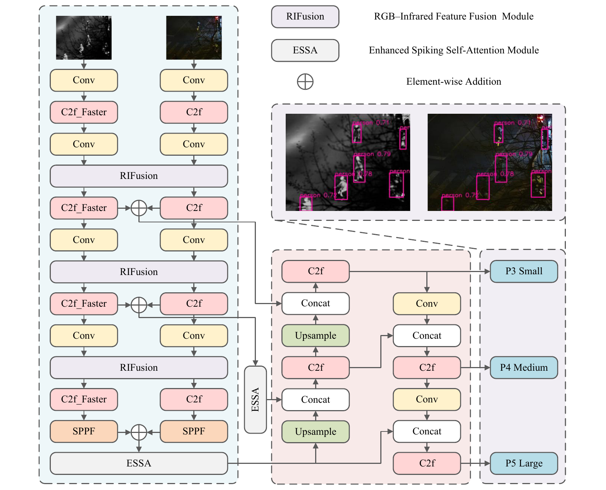
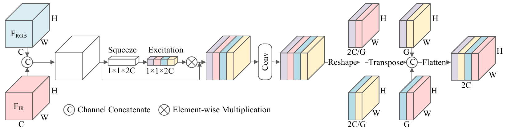
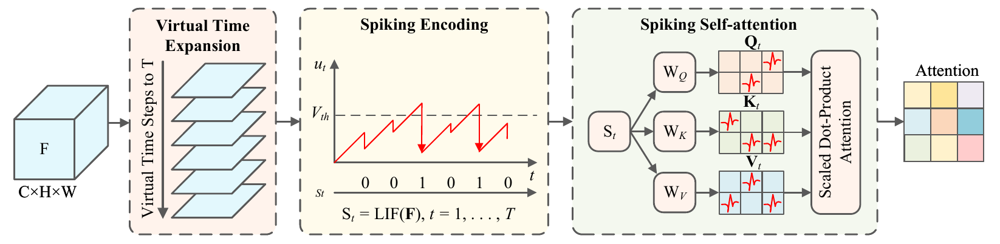

# ESSA-Net

## ESSA-Net: Virtual-Time Spiking Attention for Robust RGB–Infrared Object Detection

**Zihan Yuan, Rouyi Fan, Zhihua Liu, Yuhong Zhang, Chunhua Zhu**

[](https://www.python.org/)
[](https://pytorch.org/)
[](LICENSE)

ESSA-Net (Enhanced Spiking Self-Attention Network) is a two-stream detector for paired visible and infrared imagery. It addresses modality-dependent challenges such as poor visible-light contrast and infrared background clutter through cross-modal feature conditioning, virtual-step spiking attention, and difficulty-aware classification. The virtual time steps are internal computations on static paired images, not video frames.

This repository contains the full-model implementation and training and evaluation entry points. Dataset images and annotations are not included.

## Overall Architecture

<p align="center">
  
</p>

RGB and infrared images are processed by separate feature-extraction branches. RIFusion exchanges information between the branches, and corresponding deeper features are combined and refined with ESSA before multi-scale detection.

## Core Contributions

### RIFusion

RIFusion concatenates paired features, applies channel recalibration, and mixes and shuffles channels to support RGB–IR interaction. Its output retains the concatenated channel count and is split back into two branches.

<p align="center">
  
</p>

### ESSA

ESSA applies leaky integrate-and-fire (LIF) encoding over virtual steps and forms attention from temporally averaged spike representations. It is designed to filter fused features before detection.

<p align="center">
  
</p>

**Implementation note:** The current manuscript figure depicts Q/K/V projections after spike encoding, whereas the released code projects Q/K/V before applying LIF encoding to each branch. The illustration requires revision to match the implementation.

### ATFL

ATFL uses confidence-dependent modulation in the classification loss to adjust the contribution of samples with different prediction difficulties. The current manuscript and implementation call this **Adaptive-Threshold Focal Loss**; the alternative name “Adaptive Task Focusing Loss” requires confirmation before publication. A standalone ATFL figure is not currently available.

## Main Results on Three Datasets

All results are percentages. Per-class values and mAP50 are AP at IoU 0.50; mAP50?95 is mean AP across IoU thresholds 0.50?0.95. Comparison values are reproduced from the manuscript; methods reported from the literature may use different evaluation protocols.

### DroneVehicle

| Method | Input | Car | Truck | Freight car | Bus | Van | mAP50 |
|:--|:--|--:|--:|--:|--:|--:|--:|
| YOLOv11 | RGB | 96.4 | 74.4 | 54.2 | 95.0 | 56.3 | 75.3 |
| Hu et al. | RGB | 96.2 | 75.8 | 57.3 | 94.5 | 56.7 | 76.1 |
| DAIK | IR | 90.2 | 71.6 | 57.4 | 89.9 | 50.2 | 71.7 |
| I2MDet | IR | 96.3 | 73.4 | 65.0 | 93.2 | 58.6 | 77.3 |
| Hu et al. | IR | 98.0 | 79.5 | 67.2 | 94.8 | 58.6 | 79.6 |
| OAFA | RGB + IR | 90.3 | 76.8 | 73.3 | 90.3 | 66.0 | 79.4 |
| VIP-Det | RGB + IR | 90.4 | 78.5 | 61.4 | 89.8 | 57.5 | 75.5 |
| MROD-YOLO | RGB + IR | 96.7 | 63.2 | 47.3 | 51.9 | 93.0 | 70.4 |
| C?Former | RGB + IR | 90.2 | 68.3 | 64.4 | 89.8 | 58.5 | 74.2 |
| UAVD-Mamba | RGB + IR | 98.6 | 83.9 | 69.8 | 96.9 | 66.1 | 83.0 |
| DEAF-Net | RGB + IR | 90.5 | 83.2 | 73.0 | 90.0 | 73.0 | 81.9 |
| **ESSA-Net** | **RGB + IR** | **98.6** | **83.6** | **70.8** | **96.4** | **66.3** | **83.1** |

### LLVIP

| Method | Input | mAP50 | mAP50?95 |
|:--|:--|--:|--:|
| MFEIF | RGB + IR | 95.8 | 64.0 |
| TarDAL | RGB + IR | 94.5 | 63.3 |
| PIAFusion | RGB + IR | 96.1 | 62.4 |
| SeAFusion | RGB + IR | 96.2 | 64.0 |
| IRFS | RGB + IR | 94.0 | 60.7 |
| DEYOLO-n | RGB + IR | 96.8 | 65.4 |
| UniRGB-IR | RGB + IR | 96.1 | 63.2 |
| GLNet-YOLO | RGB + IR | 96.6 | 65.9 |
| IC-Fusion | RGB + IR | 97.9 | 70.3 |
| RSDet | RGB + IR | 95.8 | 61.3 |
| **ESSA-Net** | **RGB + IR** | **98.7** | **72.3** |

### M3FD

| Method | Input | People | Car | Bus | Motorcycle | Lamp | Truck | mAP50 |
|:--|:--|--:|--:|--:|--:|--:|--:|--:|
| U2Fusion | RGB + IR | 78.7 | 91.5 | 81.7 | 73.4 | 86.0 | 72.8 | 79.8 |
| RFN-Nest | RGB + IR | 81.5 | 92.3 | 79.7 | 71.8 | 85.9 | 72.3 | 81.3 |
| TarDAL | RGB + IR | 81.3 | 93.2 | 82.3 | 72.4 | 87.3 | 71.9 | 82.2 |
| IRFS | RGB + IR | 80.7 | 91.8 | 81.9 | 71.5 | 86.2 | 70.7 | 80.7 |
| SFDFusion | RGB + IR | 79.8 | 92.1 | 80.5 | 71.6 | 86.2 | 72.6 | 81.4 |
| YOLOv10n-RGBT | RGB + IR | 82.4 | 91.4 | 87.6 | 76.9 | 83.7 | 62.9 | 80.8 |
| YOLOv11n-RGBT | RGB + IR | 82.4 | 91.2 | 89.9 | 77.8 | 83.9 | 67.5 | 82.1 |
| **ESSA-Net** | **RGB + IR** | **83.4** | **92.3** | **88.7** | **79.1** | **85.0** | **67.6** | **82.7** |

## Ablation Studies

The component ablation below is reported on the DroneVehicle **validation** set. Values are percentages; R is recall. These results are distinct from the test-set comparison above. An enabled component is marked ✓.

| RIFusion | ESSA | ATFL | mAP50 (%) | mAP50–95 (%) | R (%) |
|:--:|:--:|:--:|--:|--:|--:|
| — | — | — | 82.8 | 62.3 | 77.9 |
| — | ✓ | — | 84.7 | 63.7 | 79.5 |
| ✓ | — | — | 83.3 | 63.1 | 78.3 |
| — | — | ✓ | 83.4 | 62.2 | 79.4 |
| ✓ | ✓ | — | 85.3 | 64.5 | 80.2 |
| — | ✓ | ✓ | 84.5 | 63.8 | 79.7 |
| ✓ | — | ✓ | 85.6 | 64.2 | 80.3 |
| ✓ | ✓ | ✓ | **86.6** | **65.6** | **81.4** |

The full configuration achieves the highest reported mAP50 in this table; partial combinations are not uniformly additive.

## Installation and Environment Preparation

The tested environment used Python 3.8.19, PyTorch 2.3.1, torchvision 0.18.1, CUDA runtime 11.8, SpikingJelly 0.0.0.0.14, and timm 1.0.19. Install the PyTorch build appropriate for your system, then install this repository:

```bash
git clone https://github.com/rouyifan/ESSA-Net.git
cd ESSA-Net
python -m pip install -r requirements.txt
```

`requirements.txt` installs the local package and dependencies declared in `pyproject.toml`. SpikingJelly is required to reproduce the LIF behavior: the fallback used when it is absent implements different dynamics. The repository includes a modified Ultralytics package; run commands from this checkout rather than substituting an unrelated installed version.

## Dataset Preparation

Obtain the datasets separately and comply with their respective terms of use:

| Dataset | Task | Dataset source |
|:--|:--|:--|
| DroneVehicle | Aerial vehicle detection | [VisDrone/DroneVehicle](https://github.com/VisDrone/DroneVehicle) |
| LLVIP | Low-light pedestrian detection | [BUPT LLVIP](https://github.com/bupt-ai-cz/LLVIP) |
| M3FD | Multi-class RGB–IR detection | [TarDAL / M3FD](https://github.com/JinyuanLiu-CV/TarDAL) |

For the supplied DroneVehicle configuration, prepare aligned RGB/IR image pairs and YOLO-format detection labels:

```text
DroneVehicle/
├── images/{train,val,test}/   # visible images
├── image/{train,val,test}/    # infrared images
└── labels/{train,val,test}/   # normalized class, x_center, y_center, width, height
```

RGB and IR images must have matching filenames and dimensions. Each label file must have the same stem as its paired images. Convert the source annotations to the required YOLO format and follow the relevant dataset split and preprocessing protocol; conversion scripts and exact manuscript split manifests for all three datasets are not included. DroneVehicle uses the class order `car`, `truck`, `bus`, `van`, `freight_car` in the supplied configuration. LLVIP and M3FD require separate dataset YAML files with the correct paths and class names; their processed data and evaluation configurations are not supplied.

Copy `configs/dronevehicle.example.yaml` and replace `/path/to/DroneVehicle` with the absolute path to the prepared data. This implementation expects the directory names `images` and `image`. Verify that `test` and `test_ir` both refer to the test split before evaluation.

## Training and Testing

### Training

```bash
python train.py --data /path/to/dronevehicle.yaml --device 0
```

The entry point constructs the full model from `configs/essa_net.yaml`. Its defaults are 260 epochs, batch size 12, image size 640, `copy_paste=0.1`, and `close_mosaic=5`; these are the released script defaults, not a guarantee that they reproduce every manuscript table. Checkpoints are saved under `runs/`.

Available overrides include `--model`, `--epochs`, `--batch`, `--imgsz`, and `--device`. Run `python train.py --help` for details.

### Testing

```bash
python test.py --weights /path/to/best.pt --data /path/to/dronevehicle.yaml \
  --split test --batch 12 --imgsz 640 --device 0
```

Use `--split val` for validation. The released `--imgsz 640` is the code's evaluation setting; the separate latency benchmark above uses 640 × 512 inputs. Run `python test.py --help` for the available options.

## License

The project includes code derived from Ultralytics YOLO and is distributed under the [GNU Affero General Public License v3.0](LICENSE). Third-party packages and datasets are subject to their own licenses and terms; consult their respective repositories before use or redistribution.

## Acknowledgements

This work was supported by the Open Research Fund of the Grain Information Processing Center of Henan University of Technology (Grant No. KFJJ2026007), the Natural Science Foundation of Henan Province, China (Grant No. 262300420307), Henan Provincial Key Scientific Research Project Program for Higher Education Institutions (Project No. 27A520006), and the National Natural Science Foundation of China (Grant No. 52379088).

## Citation
